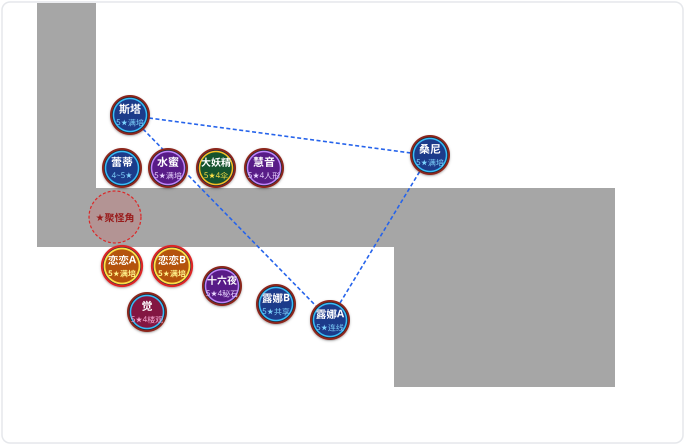
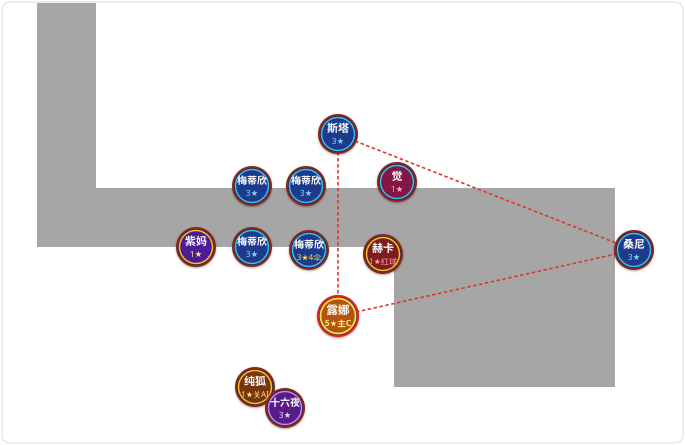

# 东方梦符祭

本地工坊物品。英文标题是 Touhou Avatar Dream Battle，内部地图名是 `touhoutd`。

## 1. 位置

| 项           | 值                                                                                      |
| ------------ | --------------------------------------------------------------------------------------- |
| 工坊 ID      | `1332364041`                                                                            |
| 工坊目录     | `C:\Program Files (x86)\Steam\steamapps\workshop\content\570\1332364041`                |
| 游戏包       | `C:\Program Files (x86)\Steam\steamapps\workshop\content\570\1332364041\1332364041.vpk` |
| 包大小       | `1079098063` 字节                                                                       |
| 发布信息     | 同目录下的 `publish_data.txt`，`source_folder` 为 `touhoutd`                            |
| 创意工坊页面 | https://steamcommunity.com/sharedfiles/filedetails/?id=1332364041                       |

游廊界面创建本地房间时，游戏直接挂载上面的工坊 VPK，`game\dota_addons\touhoutd` 下的同名散装脚本不会覆盖它。

## 2. 开局与机制增强

### 2.1 修改目标

只改自己当主机的本地对局，不改付费商店，也不改莉莉白的选卡。莉莉白仍由玩家在开局机制里自己选。

1. **选卡结束后额外发放 5 张角色卡（全员 1 星、满培养）**：
   - 秋穣子（`item_0003`）：放下后为 **1 星、满培养**（被动升星加速技能 `ability_common_star_up_speed` 升至满级）
   - 秋静叶（`item_0088`）：放下后为 **1 星、满培养**（被动升星加速技能 `ability_common_star_up_speed` 升至满级）
   - 大妖精（`item_0029`）：放下后为 **1 星 1 级、满培养**（培养技能 `ability_common_power_buff` 升至 5 级满级，二技能群体回蓝与三技能连线双攻加成直接吃满 5 级系数，且不占用卡组 SSR 配额）
   - **2 张**神绮（`item_0080 ×2`）：放下后均为 **1 星 1 级、满培养**（培养技能 `ability_common_power_buff` 升至 5 级满级，且不占用卡组 SSR 配额）
2. **开局金规则调整**（原版为基础金 `1500`，难度投票每级再加 `1000`）：
   - 修改后基础金为 `10000`，难度投票每级再加 `10000`（即 N1 为 `10000`、N2 为 `20000`、N3 为 `30000`、N4 为 `40000`）。
3. **秋穣子换星次数与特殊辅助塔同场上限调整**：
   - 秋穣子主动技能「丰收的许诺」换星次数上限由每局 `3` 次（无尽每 4 波重置）改为 **`12` 次**。
   - 特殊辅助/收益类角色（`IsBonusTower`：秋穣子 `minoriko`、秋静叶 `sizuha`、娜兹玲/老鼠 `nazrin`、莉莉白 `lily`、大妖精 `daiyousei`、寅丸星 `toramaru`、神绮 `shinki`、霍青娥 `seiga`）同时上场最大数量 `THTD_MAX_BONUS_TOWER` 由 `3` 个改为 **`5` 个**。
4. **光之三妖精（露娜 + 桑尼 + 斯塔）三角形判定失灵与连线假死修复**：
   - **修复 `common.lua` 三角形面积计算 `float32` 截断导致高达 94.5% 漏判**：原版 `GetTriangleArea(p0, p1, p2)` 将坐标差传入 C++ `Vector(...)` 构造，导致 64 位双精度浮点数被强制截断为 24 位尾数的单精度 `float32`，在大跨度三角形上产生最高约 `0.085` 的面积舍入误差，远超 `IsInTriangle` 的 `0.0001` 阈值，致使约 40% 落点组合下三角形内大量（最高 94.5%）怪物被误判在三角形外。改为纯 Lua 双精度直接计算叉积面积（误差恒为 `0`），并将判定容差放宽至 `1.0`。
   - **修复 `combo.lua` 三妖精连线标记 `thtd_combo_fairyList` 与 `thtd_fairy_combo_islink` 假死**：原版 `THTD_sunny_thtd_combo` 在未凑齐未连线三妖精前提前赋空表 `{}`（导致 `GetFairyAreaCenterAndRadiusList` 访问 `v.sunny:GetAbsOrigin()` 报空指针中断技能结算），且在场上存在第 2 只狗粮桑尼时错绑非自身单位，拔起狗粮桑尼升星/吞噬后场上三妖精残留蓝线与 `islink = true` 锁死。改为先执行断连清理、固定绑定 `sunny = self`、实时根据在场有效连线表重算 `islink` 并优先连接高星级露娜与斯塔，同时在 `GetHeroFairyList` 中增加在场最高星三妖精即时兜底。
5. **纯狐（`junko`）、赫卡提亚（`hecatia`）与神绮（`shinki`）技能图标空白及中文词条缺失修复**：
   - **修复技能图标空白**：原版 `scripts/npc/abilities/tower_abilities.kv` 中为 `thtd_junko_01`..`04`、`thtd_hecatia_01`..`04` 及 `thtd_shinki_02` 指定的 `AbilityTextureName`（`touhoutd/thtd_junko_01`..`04` 等共 9 张贴图）在原作者打包时未编译进 `1332364041.vpk` 的 `panorama/images/spellicons/` 目录与 `images.vcss_c` 样式表，导致游戏内技能栏显示为空白透明框。将其重定向至 VPK 内已预编译且闲置的东方技能图标（纯狐映射为 `ability_thdots_yumemi01`..`04`，赫卡提亚映射为 `ability_thdots_shikieiki01`..`04`，神绮二技能映射为 `touhoutd/thtd_shinki_01`）。
   - **补全中文技能名称与说明词条**：原版 `resource/addon_schinese.txt` 末尾仅录入了纯狐与赫卡提亚的单位名和卡牌名，完全缺失两人的卡牌说明、8 个技能的名称与描述以及 3 个状态 Buff 说明。在保持 `UTF-16LE` 字节长度严格不变的前提下，补全纯狐（「掌上的纯光」「杀意的百合」「原始的灵界」「纯化的狂气」）与赫卡提亚（「地球」「月球」「异界」「三位一体」）的全部中文词条。
6. **游戏内最大金钱上限突破（`99,999` → `99,999,999`，增大 3 个数量级）**：
   - 原版受 Dota 2 C++ 引擎 `CDOTA_PlayerResource` 单池 `99,999` 金币硬上限限制（且原作者在 `addon_game_mode.lua` 编写的 `OnModifyGoldFilter` 从未注册生效），导致金钱满 `99,999` 后打怪、卖卡与收益塔金钱全部溢出丢失。
   - 改为在 `addon_game_mode.lua` 中建立虚拟金库（`WALLET_CAP = 60000`，`MAX_GOLD = 99999999`）：将引擎钱包维持在 `60,000` 金币（既满足全游最贵单次购买 `35,000` 金币的扣款判定，又留出 `39,999` 金币余量防止售出物品撞到 `99,999` 引擎截断），溢出部分自动存入虚拟金库并实时同步至右下角 `#GoldText` UI 与 `PlayerResource:GetGold()`（使娜兹玲二技能按总金钱打伤害同样吃满亿级金币）。
7. **进阶的秘药 Lv1~Lv4（升级药水）与召唤符价格不显示及商店面板 Bug 修复**：
   - **修复原因**：① 原版 `scripts/npc/npc_abilities_custom.txt` 首行 `#base` 前带有 3 字节 UTF-8 BOM（`\xef\xbb\xbf`），导致 `LoadKeyValues` 解析 `AbilitiesGoldCost` 异常；② 原版 `panorama/scripts/custom_game/shop.vjs_c` 仅在 UI 加载 5 秒后单次查找 `minoriko_shop`（晚于 5 秒选人生成商店时永远为空），且漏赋 `panel.abilityname` 导致悬停不弹技能说明；③ 现代 Dota 2 原生技能框移除了 `AbilityGoldCost` 显示，选中地图上的商店单位时完全看不到秘药与召唤符价格。
   - **四重修复**：移除 `npc_abilities_custom.txt` 首行 BOM；在 `addon_game_mode.lua` 直接注入 8 个购买/召唤技能价格表；重构 `shop.vjs_c` 为每秒轮询初始化、补齐 `panel.abilityname`，并在选中商店或灵梦时直接在底部技能图标右下角渲染金色价格角标（`1000` / `1800` / `7200` / `500` / `2500` / `35000`）；同时在 `addon_schinese.txt` 的技能与物品标题和描述中直接写明金币价格与喂养经验值。
8. **神绮一技能本局卡池出卡修复、二技能词条修正、大妖精一技能直升 10 级强化与秋穣子跨星神绮能量补齐**：
   - **修复神绮一技能「魔界之门」从全图鉴乱出卡的 Bug**：原版 `addon_game_mode.lua` 的 `OnShinkiGainCard(caster)` 错误遍历全局图鉴 `towerNameList`（导致掉出大量不在本局卡组内的废卡，且未初始化星级/等级表），改为与商店抽卡一致：从**玩家本局卡池 `towerPlayerList[pid + 1]`** 中按剩余张数权重抽取对应品质卡牌（同步调用 `THTD_RemoveItemInList` 扣减库存、注册销毁/吞噬/售出自动返还监听，并在某品质抽空时按商店标准返还 `5000` / `2500` / `1000` / `250` 金币）。
   - **修复神绮二技能「恩泽大地」描述数值错误**：原版 `tower.lua` 实际按 `caster:THTD_GetStar() * 2 * upLevel`（即**神绮星级 × 2**，5 星神绮每级 `+10` 基础能量）结算，但 `addon_schinese.txt` 误写为 `（神绮星级*1）`，将其修正为 `（神绮星级*2）`。
   - **强化大妖精一技能「温婉的妖精之心」为固定 `Level = 10`**：将 `abilitydaiyousei.lua` 中主目标 `target:THTD_LevelUp(caster:THTD_GetStar())` 与周围友军 `v:THTD_LevelUp(count)` 统一强化为 **`THTD_LevelUp(10)`**（周围受影响友军数仍为 `大妖精星级` 个，但不衰减），施放一次即可让主目标与周围友军直接满级并吃满 `10` 级属性成长与 `10` 级神绮额外能量。
   - **修复秋穣子/秋静叶直升高星时漏算神绮跳星能量 Bug**：原版秋穣子将 1 星 1 级主 C 直接换为 5 星 10 级时，`THTD_SetStar(5)` 直接把星级改写为 5 星 1 级，随后 `THTD_SetLevel(10)` 仅结算 `5 星 1→10 级` 的 `9` 级神绮加成（漏掉前 4 颗星与初始级共 `41` 级加成）。在 `tower.lua` 的 `CDOTA_BaseNPC:THTD_SetStar(star)` 中增加跳星差额补偿，使 1 星 1 级主 C 被秋穣子一键换至 5 星 10 级（或经秋静叶逐星提升、或先由大妖精升满 1 星 10 级再换 5 星）时，均统一按 **5 星共 50 级** 完整结算神绮二技能能量（单 5 星神绮固定加满 **`+500` 基础能量**，主 C 满培养后折算 **`+800` 最终能量**）。

### 2.2 修改方案

直接修补工坊包 `1332364041.vpk` 内的脚本、配置与本地化文件，并重算 VPK v2 内部校验链：

1. **开局金币、发卡、亿级金库与神绮本局卡池出卡逻辑（`scripts/vscripts/addon_game_mode.lua`）**：
   - 原版在 `addon_game_mode.lua` 中通过 `GameRules:SetStartingGold(1500)` 设置基础金，并在 `DOTA_GAMERULES_STATE_STRATEGY_TIME` 阶段通过 `GameRules:SetCustomGameDifficulty(difficulty + 1)` 与 `ModifyGold(..., difficulty * 1000)` 发放难度加成金。
   - 在英雄首次出生（`isFirstSpawn == false`）后，读取当前难度级数 `difficulty = math.max(0, GameRules:GetCustomGameDifficulty() - 1)`，补齐差额金币 `8500 + difficulty * 9000`（使总开局金达到 `10000 + difficulty * 10000`）。
   - 挂钩 `CDOTA_PlayerResource.GetGold` 与 `ModifyGold` 并以 `0.1` 秒周期运行 `SyncGold(pid, 0)`：将玩家 C++ 引擎内金币维持在 `math.min(total, 60000)`，超出 `60,000` 的部分存入 `bankGold[pid]`（上限 `99,999,999`），通过 `CustomNetTables` 的 `"AbilitiesGoldCost"` 表实时同步至前端 UI，同时内置 8 个商店/召唤技能价格字典。
   - 重写 `OnShinkiGainCard(caster)`：每次出卡实时遍历玩家本局卡池 `towerPlayerList[pid + 1]`，按 `card["count"]` 权重构建对应品质抽卡池，出卡后调用 `item:THTD_RemoveItemInList(pid)` 扣减卡池库存、初始化 `thtd_hero_star_list` / `thtd_hero_level_list` 为 `1`，并注册 `thtd_item_release` 监听（卡牌被吞噬或售出销毁后自动返还回 `towerPlayerList`）；若对应品质已抽空则自动折算发放 `5000` / `2500` / `1000` / `250` 金币。
   - 在选卡阶段完成（`_G.g_PlayersCompleteStatus[pid] == 1` 且 `towerPlayerList[pid + 1]` 已生成）后，向背包发放 `item_0003`（秋穣子）、`item_0088`（秋静叶）、`item_0029`（大妖精）与 2 张 `item_0080`（神绮 ×2），初始星级与等级均记为 `1`（`RANDOM_SSR_COUNT = 0`）。
   - 挂钩 `CDOTA_BaseNPC:THTD_InitExp()`：当放下的单位对应上述赠送的 5 张角色卡时，保持 `1` 星 `1` 级（秋穣子与秋静叶为 `1` 星）不变，并循环调用 `self:THTD_SetAbilityLevelUp()` 将其培养技能升至满级（满培养）。
2. **秋穣子换星次数、特殊塔上场上限、大妖精一技能与神绮跳星能量补齐（`abilityminoriko.lua`、`abilitycommon.lua`、`abilitydaiyousei.lua` 与 `system/tower.lua`）**：
   - `scripts/vscripts/abilities/abilityminoriko.lua`（偏移 `943521236`，长度 `1069` 字节）：将 `OnMinoriko02StarChange` 中的 `hero.thtd_minoriko_02_change >= 3` 改为 `>= 12`，缩减 1 个空白缩进字节以保持文件长度不变。
   - `scripts/vscripts/abilities/abilitycommon.lua`（偏移 `943298664`，长度 `28012` 字节）：将 `THTD_MAX_BONUS_TOWER = 3` 改为 `THTD_MAX_BONUS_TOWER = 5`，文件长度保持不变。
   - `scripts/vscripts/abilities/abilitydaiyousei.lua`（偏移 `943326676`，长度 `4970` 字节）：将 `OnDaiyousei01SpellStart` 中的 `target:THTD_LevelUp(caster:THTD_GetStar())` 与 `v:THTD_LevelUp(count)` 均改为 `THTD_LevelUp(10)`，同行补齐空格保持文件长度严格为 `4970` 字节。
   - `scripts/vscripts/system/tower.lua`（偏移 `944053831`，长度 `89761` 字节）：在 `CDOTA_BaseNPC:THTD_SetStar(star)` 改写 `self.thtd_star` 前检测 `modifier_shinki_02_power_up_bonus_buff`，当 `star > self.thtd_star` 且波数 `<= 51` 时按 `upLevel = (star - self.thtd_star) * 10 + 1 - self.thtd_level`（若为 `1 星 1 级` 初始状态则再 `+ 1`）补发跳星损失的神绮能量，并精简文件头部等字节数的注释以保持文件长度严格为 `89761` 字节。
3. **三妖精三角形精度与连线自愈（`common.lua` 与 `system/combo.lua`）**：
   - `scripts/vscripts/common.lua`（偏移 `943835118`，长度 `57623` 字节）：移除 `GetTriangleArea` 中的 `Vector(...)` 包装，改用 Lua 双精度直接计算 `math.abs(((p1.x - p0.x)*(p2.y - p1.y) - (p1.y - p0.y)*(p2.x - p1.x)) / 2.0)`，并将 `IsInTriangle` 改为 `sabc > 0.1 and math.abs(sabc - sum) < 1.0`；在 `GetHeroFairyList` 中校验三妖精存活与非隐藏状态，并在连线表未就绪时自动回退取场上最高星三妖精。
   - `scripts/vscripts/system/combo.lua`（偏移 `943975453`，长度 `23318` 字节）：重构 `CDOTA_BaseNPC:THTD_sunny_thtd_combo`，先检测并清理失效连线与粒子特效，再实时扫描场上有效连线表重算 `thtd_fairy_combo_islink`，固定以当前桑尼 `self` 配对场上未连线的最高星露娜与斯塔，彻底消除空表 `{}` 报错与吞噬狗粮妖精后的假死锁。
4. **纯狐、赫卡提亚、神绮词条图标及商店秘药价格显示修复（`tower_abilities.kv`、`npc_abilities_custom.txt`、`shop.vjs_c` 与 `addon_schinese.txt`）**：
   - `scripts/npc/abilities/tower_abilities.kv`（偏移 `942418232`，长度 `316240` 字节）：将缺失编译文件的 9 个 `AbilityTextureName` 重定向至包内已预编译的闲置东方技能图标，通过调整同行空白缩进保持文件字节长度严格为 `316240` 字节。
   - `scripts/npc/npc_abilities_custom.txt`（偏移 `942742245`，长度 `16327` 字节）：去除首行 `#base` 前的 3 字节 UTF-8 BOM 并补齐同行空格，保持长度严格为 `16327` 字节。
   - `panorama/scripts/custom_game/shop.vjs_c`（偏移 `930424168`，长度 `3099` 字节，JS 段 `2315` 字节）：实时读取 `Players.GetGold(p) + bankGold` 显示至 `#GoldText`（超过 5 位数自动缩小字号避免遮挡金币图标），在底部技能栏 `Ability0..5` 动态挂载 `#TG` 金色价格标签，并将自定义商店面板改为每秒轮询初始化兼补齐 `panel.abilityname`。
   - `resource/addon_schinese.txt`（偏移 `940662744`，长度 `152624` 字节，`UTF-16LE`）：精简部分冗长角色背景故事段落与行首缩进（完整保留所有角色的 `【★】` 技能列表），补全纯狐与赫卡提亚全部中文词条，修正神绮二技能与大妖精一技能描述，并在进阶的秘药 Lv1~Lv4 与普通/进阶召唤符的技能及物品词条中补齐金币价格与经验说明，保持文件总字节长度严格为 `152624` 字节：

| 技能或词条键名                      | 修复后图标与中文显示内容                                                                                                                                                    |
| ----------------------------------- | --------------------------------------------------------------------------------------------------------------------------------------------------------------------------- |
| `item_0073_Description`（纯狐卡牌） | 心怀纯粹恨意的神灵，拥有纯化任何程度的能力（列出 ★/★/★★★/★★★★★ 四技能）                                                                                                     |
| `thtd_junko_01`（纯狐 `E`，★）      | 图标 `ability_thdots_yumemi01`；**「掌上的纯光」**：将目标友军技能伤害纯化为无视双抗与减伤的纯粹伤害（同时仅对 1 人生效）                                                   |
| `thtd_junko_02`（纯狐 `R`，★）      | 图标 `ability_thdots_yumemi02`；**「杀意的百合」**：向前方发射 50 发弹幕，造成 `能量点*星级*0.5` 纯粹伤害并叠 1 层纯化印记（最多 10 层）                                    |
| `thtd_junko_03`（纯狐 `D`，★★★）    | 图标 `ability_thdots_yumemi03`；**「原始的灵界」**：引爆 500 码内纯化印记造成 `能量点*星级*2` 纯粹伤害，未满 10 层每层 +10% 伤害，满 10 层眩晕 1 秒                         |
| `thtd_junko_04`（纯狐 `F`，★★★★★）  | 图标 `ability_thdots_yumemi04`；**「纯化的狂气」**：对 500 码内造成 `能量点*星级*20` 纯粹伤害并附加 1 秒狂气，期间受纯狐及纯光目标伤害翻倍                                  |
| `item_0074_Description`（赫卡卡牌） | 掌管月球、地球、异界三界地狱的女神（列出 ★/★/★/★ 四技能）                                                                                                                   |
| `thtd_hecatia_01`（赫卡 `E`，★）    | 图标 `ability_thdots_shikieiki01`；**「地球」**：召唤旋转地球造成 `能量点*星级*0.5` 纯粹伤害，地球形态束缚 0.5 秒，其他形态召唤 2 秒星雨                                    |
| `thtd_hecatia_02`（赫卡 `R`，★）    | 图标 `ability_thdots_shikieiki02`；**「月球」**：召唤旋转月球造成 `能量点*星级*0.5` 纯粹伤害，月球形态折射激光 AOE，其他形态击退 100 码                                     |
| `thtd_hecatia_03`（赫卡 `D`，★）    | 图标 `ability_thdots_shikieiki03`；**「异界」**：召唤旋转异界造成 `能量点*星级*0.3` 纯粹伤害，异界形态牵引周围敌人 3 秒，其他形态发射 12 发弹幕                             |
| `thtd_hecatia_04`（赫卡被动，★）    | 图标 `ability_thdots_shikieiki04`；**「三位一体」**：每秒随机切换形态，对应形态命中且地球与异界共存时生成顶点，集齐 3 顶点触发 5 秒三角激光阵（`能量点*星级*5.0` 纯粹伤害） |
| `thtd_shinki_02`（神绮被动，★）     | 图标重定向为已编译的 `touhoutd/thtd_shinki_01`（**「恩泽大地」**），描述修正为每次升级获得 **（神绮星级\*2）** 额外能量点                                                   |
| `thtd_daiyousei_01`（大妖精 `Q`）   | **「温婉的妖精之心」**：直接提升目标及周围 `星级*1` 个友方单位 **固定 10 级**（满 10 级能量成长，周围单位不衰减）                                                           |
| `shop_buy_egg_level_1..4`（秘药）   | 底部技能图标右下角直接显示金色价格（`1000` / `1800` / `7200` / `35000`），标题与说明标注价格、可代升星素材星级与喂养经验（`+4800` / `+7200` / `+9600` / `+12000`）          |

5. **等长注入与内部校验同步**：
   - 同步更新 `TreeSection` 内被修改文件的 CRC32、`ArchiveMD5Section` 对应数据块（`Chunk[886]`、`Chunk[896]`..`Chunk[900]`）的 Blake3-128 摘要、`OtherMD5Section` 中的 `TreeChecksum`（偏移 `1079097995`）与 `ArchiveMD5SectionChecksum`（偏移 `1079098011`）。

本地参考脚本保留在 `C:\Program Files (x86)\Steam\steamapps\common\dota 2 beta\game\dota_addons\touhoutd\scripts\vscripts\utils\copy_config.lua`。

### 2.3 修改结果

已按当前方案更新 `1332364041.vpk` 与本地参考脚本 `copy_config.lua`，并重算 VPK v2 校验链，文件总大小保持 `1079098063` 字节不变，待进入游戏实测验证：

| 校验项 | 原版值 → 修补后值 |
| --- | --- |
| `addon_game_mode.lua` CRC32 | `0xA627ADAE` → `0x6CAF2CBF` |
| `abilityminoriko.lua` CRC32 | `0x98FD5777` → `0x3DA2E8EF` |
| `abilitycommon.lua` CRC32 | `0xD256E4E7` → `0x46ED8D97` |
| `abilitydaiyousei.lua` CRC32 | `0x5F1E9EEF` → `0x3F4C8D6A` |
| `system/tower.lua` CRC32 | `0xB3240E27` → `0xB4C7F14E` |
| `common.lua` CRC32 | `0x901D1182` → `0x70BF47F7` |
| `system/combo.lua` CRC32 | `0x0BEB69CD` → `0xFD1A0387` |
| `tower_abilities.kv` CRC32 | `0xE34C7C43` → `0x9A167E01` |
| `npc_abilities_custom.txt` CRC32 | `0xA36CCE10` → `0x314E5107` |
| `shop.vjs_c` CRC32 | `0x7734D261` → `0xCD368A5D` |
| `addon_schinese.txt` CRC32 | `0x98D318E1` → `0xAD412C1F` |
| `Chunk[886]` Blake3-128 | `27DD054E8F9DBA78E4340065831CB86A` → `82CC44617A3EA51DD1453C42134A55E1` |
| `Chunk[896]` Blake3-128 | `274C1A82E28A86BE23A68699F417A220` → `213BA8D58319711F1F635082C74DE3D8` |
| `Chunk[897]` Blake3-128 | `E3535C67F51FACEF3C92C1B971AE112B` → `80F71607580F9A306CF2E9368D9826AC` |
| `Chunk[898]` Blake3-128 | `BF3642961CB52E8D82EE3ABB0989D8BC` → `BB6018FF306719E09E0AFA60E4F3F628` |
| `Chunk[899]` Blake3-128 | `CF80924C5E32A1714ED3E4B947ED7B4B` → `3122A2C2226972D067DF6D01EDBB8816` |
| `Chunk[900]` Blake3-128 | `395C3F9DDF61CA8D57FC2513A2112197`（已同步更新） |
| `TreeChecksum` (MD5) | `962C60C755ACE6CF30CA614FAE10593A` → `E79D45B8304594B3C3534FD93D5A47F7` |
| `ArchiveMD5SectionChecksum` (MD5) | `38E786AB7FDBC0F6FAB20E9CBE9E4836` → `175FA05AB358D9C6D721BF206C0318C1` |

付费商店没有改过。

## 3. 套路研究

### 3.1 古明地恋

以**古明地恋 + 古明地觉**为后期物理/结算双核心，搭配**光之三妖精（露娜切露德 + 斯塔萨菲雅 + 桑尼米尔克）**作为前中期无压力过渡与后期全区副 C 的 12 人口成型体系。

#### 3.1.1 核心机制、满培养套娃与同名卡双上判定

1. **满培养（吃 4 张同名卡升满 `ability_common_power_buff`）源码算法与古明地恋 `5.04x` 二次套娃**：
   - **满培养基础倍率（`tower.lua`）**：每个角色喂食 **4 张同名卡** 将培养技能升至 5 级满级后，`THTD_GetPower()` 总灵力乘算 **`×1.6`**（`1 + 4 × 15%`），`THTD_GetAttack()` 总攻击力乘算 **`×1.8`**（`1 + 4 × 20%`）；同时辅助类角色（大妖精、慧音、咲夜、水蜜等）按 `level = ability:GetLevel()` 判定技能系数的技能全部吃到 **5 级上限**。
   - **古明地恋满培养大招二次套娃（`abilitykoishi.lua` 第 145~152 行）**：恋恋开四技能大招时，代码先读取 `bonusAttack = caster:THTD_GetAttack()`（**此时已乘过一次 `1.8` 倍满培养加成**），再通过 `THTD_AddAttack(bonusAttack)` 加进基础属性池，随后每次普攻调用 `THTD_GetAttack()` 时**会再乘第二次 `1.8` 倍**！
     - **0 培养恋恋开大**：攻击力变为 $(1 + 1.0) \times 1.0 = \mathbf{2.0}$ **倍**，灵力变为 $\mathbf{2.0}$ **倍**；
     - **满培养恋恋开大**：攻击力变为 $(1 + 1.8) \times 1.8 = \mathbf{5.04}$ **倍**（比 0 培养高出 **2.52 倍**！），灵力变为 $(1 + 1.6) \times 1.6 = \mathbf{4.16}$ **倍**；连对方恋恋三技能给的 `+1000` 攻击力也会直接膨胀为 **`+5040` 攻击力**！
   - **吞噬同名卡的卡池返还机制（`abilitycommon.lua` + `addon_game_mode.lua`）**：用培养技能吞掉同名卡时，`item:THTD_RemoveSelf()` 销毁该物品后，`thtd_item_release` 定时器会在 `0.1` 秒后检测到 `item:IsNull()` 并**将吞掉的同名卡自动返还回玩家当局卡池 `towerPlayerList`**。但**只要角色插在场上，就会永久占用 1 张卡池库存**；因此若卡组只带 2 张恋恋且把 2 张都插在场上，卡池剩余库存为 `0`，就永远抽不出狗粮卡来喂满培养！**必须带 `3~4` 张恋恋（或先只下 1 个恋恋喂满 4 次后再下第 2 个）**。
2. **哪些英雄强烈推荐上 2 个（源码无互斥锁，收益翻倍）**：
   - **双露娜切露德（`luna ×2` + `star ×1` + `sunny ×1`）**：源码 `abilityluna.lua` 中，露娜一技能全区普攻与二技能激光加灵力查的是玩家级的 `GetFairyAreaCenterAndRadiusList(hero)`，**并不要求该露娜自身带蓝线**！只要场上有 1 组三妖精连成三角形，**第 2 个满培养 5 星露娜完全共享同一个三角形区域判定**（满培养每只怪提供 `500 × 1.6 = +800` 灵力、`500 × 1.8 = +900` 攻击力），仅占 R 卡配额就能白嫖第二个千万级输出核。
   - **双古明地恋（`koishi ×2`）**：两个满培养 5 星恋恋可以**互相给对方挂三技能（`+1000` 攻击与 `+1000` 灵力，持续 20 秒）**，满培养开大招时直接套娃膨胀为 **`+5040` 攻击与 `+4160` 灵力**，两人轮流/同时开近战大招可彻底解决单恋恋大招真空期问题。
3. **哪些英雄绝对不能上 2 个（源码有布尔互斥锁，多上浪费人口）**：
   - **古明地觉（`satori`）**：源码 `abilitysatori.lua` 第 22 行 `v.thtd_satori_02_debuff` 是绑在怪物身上的布尔锁，第 1 个小觉挂上 Q 的 3 秒内，第 2 个小觉放 Q **不会触发第二个 3 秒 100% 伤害复刻**；只需上 **1 个满培养 5 星小觉**，用咲夜刷新其 Q 即可。
   - **十六夜咲夜（`sakuya`）**：源码 `abilitysakuya.lua` 第 103 行规定带有 `modifier_sakuya_02_buff` 的友军不可被第二个咲夜再次刷新，且咲夜二、三技能在自身刷新黑名单内，不可互刷。
   - **上白泽慧音（`keine`）**：`target.thtd_keine_01_open` 为布尔锁，同一主 C 无法叠加两个慧音的一技能加攻。

#### 3.1.2 12 人成型阵容表（全员满培养 + 双恋恋双露娜顶配版）

全队刚好 **3 张 SSR 角色 + 3 张 SR 角色 + 6 张 R 角色 = 12 人口**，主 C 与关键辅助全部**喂满 4 张同名卡达成 5 级满培养**：

| 位置、角色与稀有度                  | 星级、培养度与职责说明                                                                                 |
| ----------------------------------- | ------------------------------------------------------------------------------------------------------ |
| 1. 古明地恋 A（`koishi`，**SSR**）  | **5 星 · 满培养（1 号物理主 C）**：吃 4 张恋恋，开大 `5.04x` 攻 / `4.16x` 灵，贴 L 拐角下沿            |
| 2. 古明地恋 B（`koishi`，**SSR**）  | **5 星 · 满培养（2 号物理主 C）**：吃 4 张恋恋，与恋恋 A 互挂三技能（开大折算 `+5040` 攻）             |
| 3. 古明地觉（`satori`，**R**）      | **5 星 · 满培养（唯一易伤/结算核）**：连携 +20% 物易伤，二技能将双恋+双露娜 3 秒伤害 100% 复刻         |
| 4. 露娜切露德 A（`luna`，**R**）    | **5 星 · 满培养（1 号法核副 C）**：三妖精右下连线顶点，满培养每只怪折算 `+800` 灵力轰炸全区            |
| 5. 露娜切露德 B（`luna`，**R**）    | **5 星 · 满培养（2 号法核副 C）**：站露娜 A 旁，**无需连线完全共享三妖精三角形全区普攻与灵力**         |
| 6. 斯塔萨菲雅（`star`，**R**）      | **4~5 星 · 满培养（三妖精左上顶点）**：全区流星雨附加 3.5 秒群体减速                                   |
| 7. 桑尼米尔克（`sunny`，**R**）     | **4~5 星 · 满培养（三妖精右上顶点）**：池子出口上方，全区折射激光与致盲 Debuff                         |
| 8. 大妖精（`daiyousei`，**SSR**）   | **4~5 星 · 满培养（面板/回蓝核）**：满培养 `level=5` 最大化三技能连线双攻加成与二技能群体回蓝          |
| 9. 十六夜咲夜（`sakuya`，**SR**）   | **4~5 星 · 满培养（刷新/时停核）**：居中刷新小觉 Q 与双露娜激光，在 L 拐角放时停球留怪                 |
| 10. 上白泽慧音（`keine`，**SR**）   | **4~5 星 · 满培养（加攻/回退控）**：满培养 `level=5` 一技能给双恋恋加基础攻击，三技能传回起点          |
| 11. 村纱水蜜（`minamitsu`，**SR**） | **4~5 星 · 满培养（拐角硬控）**：L 拐角船锚范围眩晕 + 减速                                             |
| 12. 蕾蒂（`letty`，**R**）          | **4~5 星 · 满培养（拐角冰封减速）**：与水蜜、斯塔、咲夜组成四重留怪链（也可换 **R** 卡永江衣玖 `iku`） |

#### 3.1.3 兼顾「全员满培养」与「四件套装备」的卡组配额

> **满培养抽卡铁律**：吃掉的同名狗粮卡会在 `0.1` 秒后自动返还卡池，但**插在场上的卡会占用卡池库存**。因此单上角色至少带 **2 张**（1 张站场 + 1 张在池子里反复抽出来喂 4 次），双上角色（恋恋、露娜）强烈建议带 **4 张**（即便场上已插 2 个，池子里仍有 2 张库存可供快速抽满 8 次培养）。

1. **卡组配额精确分配（10 SSR / 22 SR / 40 R）**：
   - **SSR（共 `10 / 10` 张）**：
     - 角色（6 张）：**`古明地恋 ×4`**（满编 4 张！先下恋恋 A 快速抽 4 张喂满，再下恋恋 B 抽 4 张喂满）+ **`大妖精 ×2`**（1 张站场，1 张在卡池循环抽 4 次喂满培养）。
     - 装备（4 张）：**`莱瓦汀 ×4`**（`item_2013`，给 1 号恋恋凑齐 SSR 四件套：+24% 物伤与 +10% 范围物伤光环）。
   - **SR（共 `22 / 22` 张）**：
     - 角色（6 张）：**`十六夜咲夜 ×2`** + **`上白泽慧音 ×2`** + **`村纱水蜜 ×2`**（每人带 2 张：1 张站场，另 1 张在卡池里反复抽 4 次喂满 5 级培养）。
     - 装备（16 张，刚好 **4 套完整 SR 四件套**）：**`楼观剑 ×4`**（`item_2009`，+15% 物穿，4 件套技能使目标受物理伤害 +10%）+ **`死神大镰刀 ×4`**（`item_2026`，+12% 物伤，4 件套对 30% 血以下单位 1.5 倍斩杀）+ **`破魔净灵札 ×4`**（`item_2010`，+15% 法穿，4 件套技能使目标受魔法伤害 +10%）+ **`割夺真实之刃 ×4`**（`item_2025`，+12% 法伤，4 件套对 70% 血以上单位 1.5 倍压血）。
   - **R（共 `40 / 40` 张）**：
     - 角色（20 张）：**`露娜 ×4`**、**`小觉 ×3`**、**`斯塔 ×3`**、**`桑尼 ×3`**、**`蕾蒂 ×3`**、**`莉莉白 ×1`**、**`娜兹玲(老鼠) ×3`**（R 卡池深，主力带 3~4 张可极速抽齐 4 次满培养）。
     - 装备（20 张，刚好 **5 套完整 R 四件套**）：**`血染的太阳伞 ×4`**（1000 码友军 **+50% 攻击光环**）+ **`月耀秘石 ×4`**（1000 码友军 **+20% 回蓝光环**）+ **`灾厄之主人形 ×4`**（1000 码敌军 **-10% 移速光环**）+ **`死神渡河船桨 ×4`**（+15% 暴击率，4 件套 **+100% 暴击伤害**）+ **`月面之弩 ×4`**（+20% 攻击，4 件套 **+200 攻击距离**）。
2. **主力与挂件 6 格背包穿戴表（严格对应上方卡组库存）**：

| 穿戴角色                           | 6 格毕业装备穿戴组合（4 件套 + 2 件套）                                                                                                                                    |
| ---------------------------------- | -------------------------------------------------------------------------------------------------------------------------------------------------------------------------- |
| **1. 古明地恋 A（1 号满培主 C）**  | **`莱瓦汀 ×4`**（SSR 四件套：+24% 物伤与 +10% 范围物伤光环）+ **`死神渡河船桨 ×2`**（+15% 暴击率）                                                                         |
| **2. 古明地恋 B（2 号满培主 C）**  | **`死神大镰刀 ×4`**（SR 四件套：+12% 物伤，对 30% 血以下 **1.5 倍斩杀**）+ **`死神渡河船桨 ×2`**                                                                           |
| **3. 古明地觉（满培易伤/结算核）** | **`楼观剑 ×4`**（SR 四件套：Q 一下同时挂 **+20% 觉恋物易伤 + 10% 楼观剑物易伤 = +30% 物理易伤**！）                                                                        |
| **4. 露娜 A（1 号满培法核副 C）**  | **`破魔净灵札 ×4`**（SR 四件套：+15% 法穿，激光给全区怪挂 **+10% 魔法易伤**）+ **`月面之弩 ×2`**                                                                           |
| **5. 露娜 B（2 号满培法核副 C）**  | **`割夺真实之刃 ×4`**（SR 四件套：+12% 法伤，对 70% 血以上满血怪 **1.5 倍开局压血**）+ **`月面之弩 ×2`**                                                                   |
| **8/9/10. 大妖精/咲夜/慧音**       | 一人穿一套 R 级团队光环 4 件套：**大妖精穿 `血染的太阳伞 ×4`**（全队 +50% 攻）、**咲夜穿 `月耀秘石 ×4`**（全队 +20% 回蓝）、**慧音穿 `灾厄之主人形 ×4`**（敌军 -10% 移速） |

#### 3.1.4 站位图（右侧正方形怪物池 + 左侧 L 型路口）

地形说明（以 1P 左上场地视角为例，`spawner.lua` 坐标）：

- **右侧**为带有漩涡地砖的**正方形怪物池子**（`(-1408, 1056)`），怪物从池子左侧铁拱门出来**向左走（`<===`）**；
- 走到左侧尽头的 **L 型直角拐角（`★`，`(-2771, 1056)`）** 后，**直角向上拐弯（`^`）** 走向外圈通道；
- 上排与下排石板路外侧草地为放塔区，三妖精连成的三角形正好斜跨 L 型通道并罩住 `★` 拐角聚怪点（矢量图文件见 [东方梦符祭-古明地恋站位图.svg](东方梦符祭-古明地恋站位图.svg)）：

站位与操作要点：

1. **左下 L 拐角双恋恋贴脸斩杀（`[1.恋恋A]` + `[2.恋恋B]`）**：
   - 两个 5 星恋恋并排贴在左下 L 拐角下沿，**恋恋 A 的三技能点给恋恋 B，恋恋 B 的三技能点给恋恋 A**（互相常驻 `+1000` 基础攻/`+1000` 基础灵力，满培养开大招二次套娃直接膨胀为 `+5040` 攻/`+4160` 灵力），近战 800 码分裂完全覆盖 `★ L型拐角`。
2. **右下双露娜共享三角形（`[4.露娜A]` + `[5.露娜B]`）**：
   - `[4.露娜A]` 与 `[6.斯塔]`、`[7.桑尼]` 连成大三角形罩住 `★` 拐角；`[5.露娜B]` 紧挨露娜 A 放置，直接白嫖同一个三角形的怪数灵力暴涨与全区普攻轰炸，且两人都吃得到旁边 `[9.咲夜]` 的二技能刷新。
3. **小觉穿 `楼观剑 ×4` 的 30% 物理易伤联动**：
   - 让 `[3.小觉]` 穿齐 4 把楼观剑，一个 Q 砸在 `★` 拐角，怪物同时吃 **觉恋连携 +20% 物理易伤 + 楼观剑四件套 +10% 物理易伤 = +30% 物理易伤**，双恋恋在 3 秒内砍出的成吨伤害再被小觉二技能 **100% 等额复刻炸死**。

### 3.2 纯狐露娜三月精

以**单 5 星露娜切露德**为唯一满星主 C，搭配 **1 星纯狐（纯化伤害挂件）+ 4 个 3 星梅蒂欣（2×2 夹道毒池把怪往右拽回三角形）+ 1 星八云紫（最左兜底）+ 1 星赫卡提亚（贴脸定球）** 的超低造价 12 人口挂机过 EX 体系。全队仅需培养 1 个 5 星，普通运营 40 波左右即可成型收工。

#### 3.2.1 核心机制与站位深层逻辑

1. **为什么三妖精三角形在右、4 个梅蒂欣在左（`abilitymedicine.lua` + `ai/common.lua`）**：
   - 看原图红虚线：**斯塔（上高地）— 露娜（下半腰）— 桑尼（最右侧刷怪池右外缘）** 围出的直角大三角形**朝右覆盖了整个刷怪池上半部与出口段**，而 **4 个梅蒂欣（上下 2×2 对齐）与八云紫（最左）全部排在「斯塔—露娜」竖直红线的左侧（下游）**。
   - 底层原因在 `ai/common.lua` 第 1514 行（`THTD_medicine_thtd_ai`）：梅蒂欣放二技能毒池时，目标点公式为 `point = unit:GetAbsOrigin() + 350 * GetUnitBackWardVector(unit)`——即**自动往排头怪身后来路方向（向右）退后 350 码丢毒圈**，并强制把怪的寻路终点锁回毒圈中心（`v.next_move_point = targetPoint`）！
   - 因此 4 个梅蒂欣站在竖线左侧，一旦有怪刚走出三妖精三角形左边界，4 个梅蒂欣就会把毒池丢在竖线右侧（三角形内部），**把走出三角形的怪硬生生往右拽回三妖精三角形里**反复挨炸！
   - 而 **1 星八云紫** 单独站在下排最左侧（4 个梅蒂欣的左边），专门兜底吞掉极少数冲出 2×2 毒阵的高速怪（如文文）并拉回重走。
2. **为什么露娜悬在半腰、纯狐与咲夜孤悬在地图最底端（距离隔离法）**：
   - **咲夜沉底（距离上方道路 > 1000 码，距离半腰露娜 < 1000 码）**：
     - 咲夜普攻与三技能时停判定半径为 `800` 码，一技能飞刀与二技能刷新半径为 `1000` 码。把咲夜拉到地图最底端后，她**完全够不到上方道路的怪**，从而**彻底屏蔽咲夜的平 A、飞刀与时停抬手动作**（既不浪费施法前摇，也不会乱放时停打乱梅蒂欣拉怪回三角形的节奏）。
     - 同时，咲夜 1000 码友军圈内只有旁边的纯狐（无耗蓝/长 CD 技能，`NeedRefreshAbility()` 恒为 `false`）和半腰的露娜，**物理距离上完全够不到上面的梅蒂欣、八云紫、赫卡和小觉**，实现 100% 零失误专职刷新露娜。
   - **露娜悬在下半腰（承上启下中枢位）**：
     - 向上距离水平通道约 600~800 码：刚好在二技能 1000 码激光射程内，且刚好能吃到上方紧邻竖线的「右下梅蒂欣」身上的 **`血染的太阳伞 ×4`（1000 码 +50% 攻击光环）**；
     - 向下距离最底端的纯狐与咲夜在 1000 码内：刚好作为唯一合法友军目标吃到纯狐一技能与咲夜二技能。
3. **纯狐一技能纯化与伤害提前结算（`damage.lua`）**：
   - 1 星纯狐对露娜施放一技能（`modifier_junko_01`）后，露娜所有伤害强制转为 **`DAMAGE_TYPE_PURE`（纯粹伤害）**，且在 `ReturnAfterTaxDamage`（第 115 行）中**直接 `return DamageTable.damage` 提前返回**：直接无视无尽 Boss 减伤词条（键山雏、琪斯美等），同时跳过装备暴击、百分比增伤与常规易伤乘区。
   - 因此露娜只堆面板灵力：穿 **`高科技相机 ×2`（`item_2020`，+12% 灵力）+ `纳税用阴阳玉 ×4`（`item_2019`，+12% 灵力与 +200 基础灵力）**，靠二技能激光对三角形内每只怪 **`+500` 灵力与 `+500` 攻击力** 打真实伤害爆发。
4. **赫卡提亚「红球放脸上」定点机制（`abilityhecatia.lua`）**：
   - 赫卡提亚站在刷怪池左上内拐角（三角形内部），只用三技能（异界红球）点击屏幕底部自身头像施放，旋转半径 `distance = 0`（第 704 行），红球永久钉在自己脸上贴路输出。

#### 3.2.2 12 人口成型阵容与精准坐标表

全队共 **11 个单位（12 人口，八云紫占 2 人口）**，按原图从上到下、从左到右的实际站位排列如下：

| 原图区域与具体位置                          | 角色、星级与穿戴/操作说明                                                                                         |
| ------------------------------------------- | ----------------------------------------------------------------------------------------------------------------- |
| **【最上方】高地居中（远离路沿）**          | **1. 斯塔萨菲雅（3 星 或 1 星）**：三妖精**上顶点**，与下方露娜严格垂直对齐                                       |
| **【上排路沿】左起第 1、第 2 位**           | **2~3. 梅蒂欣 ×2（3 星 ×2）**：站在「斯塔—露娜」竖线左侧，与下排两个梅蒂欣对齐成 2×2 方阵                         |
| **【上排路沿】右起第 1 位（竖线右侧）**     | **4. 古明地觉（1 星，可满培）**：站在三角形内部上沿，给刚出池子的怪挂减速圈                                       |
| **【下排路沿】左起第 1 位（最左侧）**       | **5. 八云紫（1 星，占 2 人口，可满培）**：站在 4 个梅蒂欣最左边，兜底把冲出毒阵的漏网怪隙间拉回                   |
| **【下排路沿】左起第 2、第 3 位**           | **6~7. 梅蒂欣 ×2（3 星 ×2）**：与上排组成 2×2 夹道毒阵；**第 3 位（紧邻竖线、离露娜最近）可穿 `血染的太阳伞 ×4`** |
| **【下排路沿】右起第 1 位（池子左上内角）** | **8. 赫卡提亚（1 星）**：站在三角形内部拐角，三技能红球点自己底部头像定在脸上                                     |
| **【最右侧】刷怪池右外缘中段**              | **9. 桑尼米尔克（3 星 或 1 星）**：三妖精**右顶点**，把三角形拉满整个刷怪池与出口                                 |
| **【下半腰】斯塔正下方中段（不贴路）**      | **10. 露娜切露德（5 星，唯一主 C）**：三妖精**下顶点**，穿 **`高科技相机 ×2` + `纳税用阴阳玉 ×4`**                |
| **【最底端】露娜左下方远端（2 人紧贴）**    | **11. 纯狐（1 星，左上）+ 12. 十六夜咲夜（3 星，右下）**：远离道路 >1000 码，仅够得着半腰的露娜                   |

#### 3.2.3 1:1 还原原帖最优站位图与操作细节

严格按贴吧原图几何比例、红虚线三角形边界与各头像像素圆心坐标 1:1 绘制（矢量图文件见 [东方梦符祭-纯狐露娜站位图.svg](东方梦符祭-纯狐露娜站位图.svg)）：

必做操作细节（决定无尽能否稳定挂机过 EX）：

1. **1 星纯狐操作**：场上摆好半腰的露娜和最底端的纯狐后，手动用纯狐**一技能点一次露娜**，随后**立即关闭纯狐 AI**。
2. **1 星赫卡提亚操作**：站在灰色刷怪池左上内拐角，只使用**第三个技能「异界球（红色的球）」**，鼠标直接**点击屏幕底部赫卡提亚自己的头像**施放，让红球定死在自己脸上。
3. **3 星咲夜操作**：位置摆在最底端（纯狐右下，距离半腰露娜 < 1000 码、距离上方道路 > 1000 码），**先关闭咲夜 AI → 手动用二技能给露娜套一次刷新 → 再重新打开咲夜 AI**。
4. **进无尽后露娜没输出的原因与底层修复**：原版 50 波进无尽后偶发露娜打不出伤害，是因为 `common.lua` 中 `GetTriangleArea` 将坐标差包入 C++ `Vector(...)` 截断为 `float32` 导致最高 94.5% 的区域漏判，以及 `combo.lua` 中三月精连线标记 `thtd_combo_fairyList` / `thtd_fairy_combo_islink` 在场上蹭经验的同名狗粮妖精被拔起吞噬后假死（蓝线仍在但连线表已丢失或为空表 `{}`）。本地补丁已从源码层修复上述两处缺陷；若在未打补丁的对局中遇到，只需**把露娜、桑尼、斯塔三只妖精全部拔起来再原位插回去一次**即可恢复。
5. **前 50 波过渡提示**：前 50 波单靠 5 星露娜即可守完；若中期未凑齐相机前出现清怪慢或漏怪，可先给露娜戴上 4 个「纳税用阴阳玉」并早下 1 星纯狐挂上纯化 Buff。

#### 3.2.4 全员 5 星满培养与顶配神装进阶方案

原帖之所以只升 1 个 5 星露娜、其余全是 1 星/3 星，是因为原版狗粮与经济极其紧张。在本地增强版（开局满培双秋 + 12 次秋穣子换星）下，将该阵容**全员升至 5 星并喂满 4 次培养**，会在底层代码中解锁 **5 个质的飞跃**（且无任何负面冲突）：

1. **全员升 5 星 · 满培养的 5 大源码级质变**：
   - **质变一：5 星古明地觉（`1★ → 5★`）——总输出直接翻倍**：
     - 1 星小觉只有 Q 圈减速；升到 **5 星** 后解锁二技能 `thtd_satori_02`（`thtd_satori_02[5] = 1.0`），会将圈内怪物在 3 秒内损失的生命值按 **`100%` 等额再结算一次纯粹伤害（`DAMAGE_TYPE_PURE`）**！相等于让露娜在 3 秒内打出的伤害直接 `×2`。
   - **质变二：5 星桑尼（`3★ → 5★ · 满培`）——全队其余 9 人集体获得「纯粹伤害 + 25% 增伤」**：
     - 看 `damage.lua` 第 98 行：只要三角形内的怪物挂着桑尼二技能 `modifier_sunny_02_debuff`，场上所有未挂纯狐 Buff 的友军（斯塔、4 个梅蒂欣、八云紫、赫卡、小觉）打出的伤害**全部强制转为无视护甲/魔抗的纯粹伤害（`DAMAGE_TYPE_PURE`）**，且额外增伤从 3 星的 `+10%` 提升至 **5 星的 `+25%`**！
   - **质变三：5 星斯塔（`3★ → 5★ · 满培`）——解锁全三角形 21 波流星雨**：
     - 3 星斯塔只有单发流星；升到 **5 星 · 满培养** 后解锁二技能 `thtd_star_02`，每次施法会对**三妖精三角形内的每一只怪**各自降下 **21 波 300 码 AOE 流星雨**！怪群密集时多波流星雨互相重叠，且全程吃 5 星桑尼的「纯粹伤害 + 25% 增伤」，瞬间化身二号全区主 C。
   - **质变四：5 星赫卡提亚（`1★ → 5★ · 满培`）——贴脸红球升级为 500 码黑洞**：
     - 1 星赫卡定在脸上的红球只能射小弹幕；升到 **5 星** 解锁四技能形态切换后，一旦切到异界形态（`HECATIA_TYPE_OTHERWORLD`，`abilityhecatia.lua` 第 871 行），定在赫卡脸上的红球每次触发都会形成**持续 3 秒、半径 500 码的强力黑洞**（每 0.03 秒把怪往赫卡脸上强拉 10 码），在池子出口拐角把怪吸得死死的。由于 5 星赫卡四技能每隔几秒在地球/月球/异界 3 种形态间随机切换（`RandomInt(1, 3)`），单赫卡约有 2/3 时间不处于异界黑洞形态；**实战中可直接拔掉左侧最远端打不到怪、全程看戏的 1 个梅蒂欣，在原赫卡旁边（或对侧上排）补上第 2 个 5 星赫卡提亚（同样红球点自身头像定脸，构成 `双赫卡 + 三梅蒂欣`）**，两人独立切形态即可实现池子出口全程无缝双黑洞焊死（卡组带 `赫卡提亚 ×3` 以留 1 张在卡池喂满培养）。
   - **质变五：5 星八云紫（`1★ → 5★ · 满培`）+ 5 星纯狐（`1★ → 5★ · 满培`）**：
     - **5 星八云紫**解锁四技能「无人废线车辆炸弹」（5 辆电车沿跑道逆向冲锋，每 0.3 秒眩晕沿途怪物 0.5 秒），连文文都跑不出去；
     - **5 星纯狐**解锁四技能大招 `thtd_junko_04`：看 `damage.lua` 第 35 行，被纯狐大招命中的怪物会挂上 `modifier_junko_04_debuff`，使**纯狐自身与挂了纯狐一技能的露娜对其造成的纯粹伤害直接 `×2`（翻倍）**！（注：`ai/common.lua` 第 1658 行中纯狐 AI 只放 2/3/4 技能、绝不自动改绑 1 技能；若想吃这 `×2` 大招翻倍，可将 5 星纯狐挪到露娜左上方靠近路沿处并保持 AI 开启，但需先确认咲夜已锁死刷新露娜）。
2. **全员 5 星满培养卡组配额与 6 格神装分配（10 SSR / 22 SR / 40 R）**：
   - 由于这套阵容只用了 **1 个 SR 角色（咲夜）**，你的 **22 张 SR 卡位可以塞满整整 5 套 SR 四件套神装**：
     - **SSR（10 张）**：`纯狐 ×2` + `赫卡提亚 ×2` + `八云紫 ×2`（6 张角色，1 张站场 + 1 张留卡池循环喂满 4 次培养）+ **`神枪冈格尼尔 ×4`**（4 张装备）。
     - **SR（22 张）**：`十六夜咲夜 ×2`（2 张角色）+ **`纳税用阴阳玉 ×4`** + **`高科技相机 ×4`** + **`速融的核融合棒 ×8`（2 套）** + **`割夺真实之刃 ×4`**（20 张装备，共 5 套完整 SR 四件套）。
     - **R（40 张）**：`露娜 ×4` + `梅蒂欣 ×6`（场上插 4 个，池子留 2 张循环喂满培养）+ `斯塔 ×2` + `桑尼 ×2` + `小觉 ×2` + `莉莉白 ×1` + `老鼠 ×3`（20 张角色）+ **`血染的太阳伞 ×4`** + **`月耀秘石 ×4`** + **`灾厄之主人形 ×4`** + **`月面之弩 ×8`（2 套）**（20 张装备）。

| 5 星满培养角色                           | 顶配 6 格神装穿戴方案（吃满 22 张 SR 装备富裕配额）                                                                                                                                                                |
| ---------------------------------------- | ------------------------------------------------------------------------------------------------------------------------------------------------------------------------------------------------------------------ |
| **10. 露娜（5★ · 满培养，1 号主 C）**    | **`纳税用阴阳玉 ×4`**（+12% 灵力 + 200 基础灵力）+ **`高科技相机 ×2`**（+12% 灵力）                                                                                                                                |
| **1. 斯塔（5★ · 满培养，2 号全区副 C）** | **`割夺真实之刃 ×4`**（对 >70% 血怪 **1.5 倍伤害**）+ **`高科技相机 ×2`**（+12% 灵力，21 波流星雨全区轰炸）                                                                                                        |
| **12. 十六夜咲夜（5★ · 满培养）**        | **`速融的核融合棒 ×4`**（**-25% 技能冷却**，使二技能刷新球 CD 从 15 秒缩短至 **11.25 秒**！）                                                                                                                      |
| **4. 古明地觉（5★ · 满培养，复刻核）**   | **`速融的核融合棒 ×4`**（**-25% 技能冷却** + 回蓝，高频无缝铺 Q 圈触发 3 秒 100% 掉血复刻）                                                                                                                        |
| **9. 桑尼 / 8. 赫卡提亚（5★ · 满培养）** | **`月面之弩 ×4`**（+15% 攻 + 6% 灵力 + 200 射程），另一人穿 **`月面之弩 ×4`**                                                                                                                                      |
| **2/3/6/7. 梅蒂欣 ×4（5★ · 满培养 ×4）** | 4 只梅蒂欣一人穿一套团队光环四件套：**7 号穿 `血染的太阳伞 ×4`**（+50% 攻）、**3 号穿 `月耀秘石 ×4`**（+20% 回蓝）、**6 号穿 `灾厄之主人形 ×4`**（敌军 -10% 移速）、**2 号穿 `神枪冈格尼尔 ×4`**（+7.5% 全伤光环） |

### 3.3 双神绮刷能量开局

以 **2 个【SSR】神绮（`shinki`）+ 大妖精（`daiyousei`）+ 秋穣子 + 秋静叶** 为前 50 波运营底座，无需上娜兹玲（老鼠）打钱，直接靠双 5 星神绮每波白送 **10 张高级卡** 实现经验狗粮与卖卡经济完全自由，同时利用二技能「恩泽大地」、大妖精一技能（`Level = 10`）与秋穣子换星机制为主 C 永久刷出满额基础能量点（灵力）。

1. **为什么双神绮开局不需要上老鼠（`nazrin`）**：
   - 本地增强版已将收益塔同场上限 `THTD_MAX_BONUS_TOWER` 提升至 **5 个**，刚好放下 **`秋穣子 + 秋静叶 + 大妖精 + 神绮 A + 神绮 B = 5 个`** 特殊辅助位；
   - 双 5 星神绮一技能「魔界之门」每波结束直接在神社门口掉落 **10 张高级式神卡（75% R / 20% SR / 5% SSR）**，直接喂经验或卖店每波收益高达 **6,000 ~ 12,000+ 金币**，远超单老鼠敲钱效率。
2. **「恩泽大地」5 星共 50 级能量结算与修复后机制（`tower.lua` + `abilitydaiyousei.lua`）**：
   - **每级 `神绮星级 × 2` 额外能量（已修复词条）**：`tower.lua` 实际执行 `self:THTD_AddPower(caster:THTD_GetStar() * 2 * upLevel)`——即 **5 星神绮** 2000 码内友军每升 1 级永久 **`+10` 基础能量**。
   - **大妖精一技能强化为 `Level = 10`（单次直升满级）**：`THTD_LevelUp(10)` 每次施放使主目标及周围友军直接满级，并按完整 **10 级** 结算属性成长与神绮额外能量（5 星神绮下每颗星直接 **`+100` 基础能量**，5 颗星共 **50 级 = `+500` 基础能量**）。
   - **秋穣子/秋静叶跨星直升自动补齐 50 级神绮能量**：修复后，`CDOTA_BaseNPC:THTD_SetStar(star)` 会自动按 `upLevel = (star - self.thtd_star) * 10 + 1 - self.thtd_level`（`1 星 1 级` 初始状态再 `+ 1`）补发跳星差额能量，再叠加随后 `THTD_SetLevel(10)` 的 `9` 级。因此将 **1 星 1 级主 C 直接用 5 星秋穣子换至 5 星 10 级** 时，一次性完整吃满 **`41 + 9 = 50` 级** 神绮能量（5 星神绮下固定 **`+500` 基础能量**，主 C 满培养 `×1.6` 后折算 **`+800` 最终灵力**）；若继续用秋穣子 12 次换星来回互换主 C 星级，每次重换至 5 星均可再额外刷出一轮神绮能量。
3. **双神绮叠加规则与防吞能量铁律**：
   - **一技能「魔界之门」100% 独立叠加且从本局卡池出卡**：每波结束（`SpawnSystem:GetWave() <= 51`）每个放下满 30 秒的神绮独立触发一次出卡，双 5 星神绮每波固定从玩家本局卡池 `towerPlayerList` 中抽出 **10 张高级卡**（直接抽出卡组里的核心角色、同名培养卡与四件套装备；被吞噬或卖店后自动返还回本局卡池，某品质抽空时自动折算发放 `5000` / `2500` / `1000` / `250` 金币）。
   - **二技能「恩泽大地」不叠加，且谨防低星神绮抢光环**：`FindModifierByName("modifier_shinki_02_power_up_bonus_buff")` 只读取单位身上的第 1 个神绮光环。若先放了 1 星神绮 A、后放了 5 星神绮 B，主 C 身上的光环施法者会锁在 **1 星神绮 A** 身上（每级只加 `+2` 而非 `+10`）。**把第 1 个神绮升到 5 星后，务必将另一个低星神绮拔起重新插一次（或插在距主 C >2000 码的角落）**，并在第 50 波打完后将双神绮与大妖精、双秋拔掉卖钱腾出决战人口。
